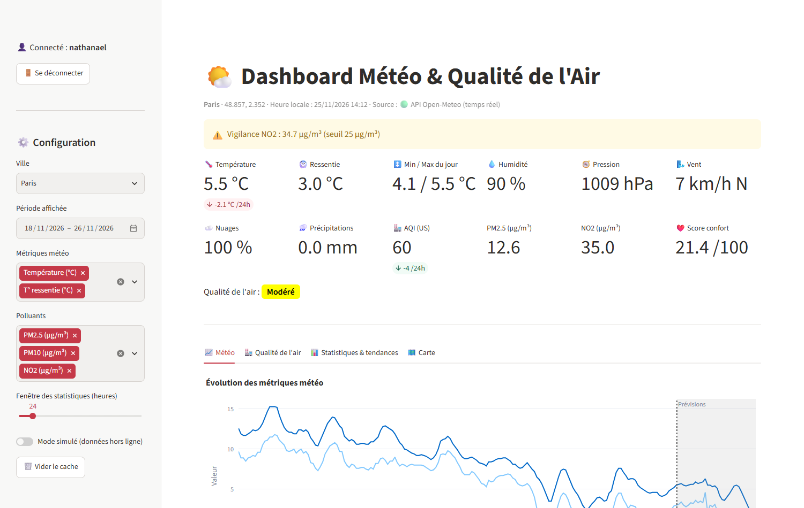

# 🌤️ Dashboard Météo & Qualité de l'Air

Application Python (Streamlit) qui récupère en temps réel les données météo et de qualité de l'air
de 5 villes via l'API publique **Open-Meteo**, les met en cache (SQLite, TTL 30 min), calcule
statistiques, tendances et un score Santé/Confort, et déclenche des alertes selon les **normes OMS 2021**.
L'accès est protégé par une page de connexion.



## Fonctionnalités
| Exigence du cahier des charges | Réalisation |
|---|---|
| 5 villes, données météo et air complètes | Paris, Lyon, Marseille, Londres, Madrid (+ toute ville via géocodage). Température, ressentie, min/max, humidité, pression, vent (vitesse + direction), nuages, précipitations ; AQI US/EU, PM2.5, PM10, NO2, O3, CO, SO2 |
| Cache local avec TTL | `CacheManager` : SQLite `data/cache.db`, 30 min, requêtes paramétrées |
| Statistiques et tendances | Moyenne, médiane, min, max, écart-type sur N heures (6 à 168) ; tendance 24 h (fenêtre vs fenêtre précédente) et 7 jours (régression linéaire) ; synthèse journalière |
| Score Santé/Confort | `100 − (|T ressentie − 21|×2 + |HR − 50|×0,4 + PM2.5/15×15 + NO2/25×10)`, borné 0–100 |
| Alertes OMS | Moyennes glissantes (24 h, 8 h pour l'O3) : « Vigilance NO2 », « Alerte Pic de Pollution NO2 », « Alerte Canicule »… |
| Interface | Filtres (ville, période, métriques, polluants, fenêtre), 12 KPI, graphiques Plotly avec zone de prévision, carte OpenStreetMap colorée par AQI |
| Gestion des erreurs | Réseau, HTTP ≥ 400, JSON corrompu, réponse `error` de l'API → `APIError` puis repli sur des données simulées (la source affichée devient « Données simulées ») |
| Authentification (ajout du planning) | PBKDF2-HMAC-SHA256 600 000 itérations, sel, message générique, verrouillage après 5 échecs, expiration de session 30 min |

> Consigne du planning : **pas de fonctionnalités supplémentaires** — les bonus du cahier des charges
> (prédiction ML, export) n'ont pas été réalisés. Seul le repli sur des données simulées, qui fait partie de la
> gestion d'erreurs, est présent.

## Installation et lancement
```powershell
python -m pip install -r requirements.txt
copy .env.example .env            # facultatif : réglages (aucune clé d'API nécessaire)
python -m src.auth add <identifiant>   # créer un compte (mot de passe saisi de façon masquée)
streamlit run app.py              # http://localhost:8501
python -m pytest -v               # tests unitaires
```
Rapports de tests (41/41 réussis, couverture du code) : [docs/tests/](docs/tests/README.md).

Dans VS Code : **F5** lance le dashboard (`.vscode/launch.json`), et les tâches « pytest » / « dashboard » sont disponibles.

## Architecture
```
dashboard_meteo/
├── app.py                 # point d'entrée Streamlit
├── src/
│   ├── config.py          # villes, variables, seuils OMS, lecture du .env
│   ├── api_client.py      # CacheManager, WeatherAPIClient, APIError, données simulées
│   ├── data_processing.py # DataProcessor : DataFrame, nettoyage, score, stats, tendances
│   ├── alerts.py          # Alert, AlertEngine, aqi_category
│   ├── auth.py            # comptes, hachage, anti-bruteforce, CLI
│   └── dashboard.py       # page de connexion + interface Streamlit/Plotly
├── tests/                 # test_api.py, test_processing.py, test_auth.py
└── data/                  # cache, comptes (non versionnés)
```
Parcours d'une requête : `dashboard` → `WeatherAPIClient.fetch()` (mode simulé ? → cache valide ? → API →
repli simulé) → `DataProcessor.to_dataframe()` → `AlertEngine.evaluate()` / `stats()` / `trend()` → KPI et graphiques.

## Exemple
```python
from src.api_client import WeatherAPIClient
from src.data_processing import DataProcessor
from src.alerts import AlertEngine

client = WeatherAPIClient()
raw = client.fetch(48.8566, 2.3522)          # Paris
df = DataProcessor.to_dataframe(raw)
print(client.last_source)                    # "api", "cache" ou "mock"
print([a.message for a in AlertEngine.evaluate(df)])
```

## Sécurité (après-midi)
Lancement sécurisé : Streamlit n'écoute que sur `127.0.0.1:8501`, Caddy fournit le HTTPS et les en-têtes de sécurité.
```powershell
streamlit run app.py
caddy run --config Caddyfile --adapter caddyfile     # → https://localhost:8443
docker compose up --build                            # variante conteneurisée (non testée sur le poste)
```
- Inscription fermée par défaut (`ALLOW_SIGNUP=false`) : créer les comptes avec `python -m src.auth add <id>`.
- Verrouillage du compte (5 échecs → 5 min), limite par IP (20 échecs / 15 min), journal `data/security.log`.
- Audit complet (ZAP, Bandit, pip-audit, revue manuelle, 13 vulnérabilités corrigées) :
  [docs/securite/RAPPORT_SECURITE.md](docs/securite/RAPPORT_SECURITE.md).
- CI/CD : `.github/workflows/ci-securite.yml` (pytest, Bandit, pip-audit, Gitleaks, OWASP ZAP).
